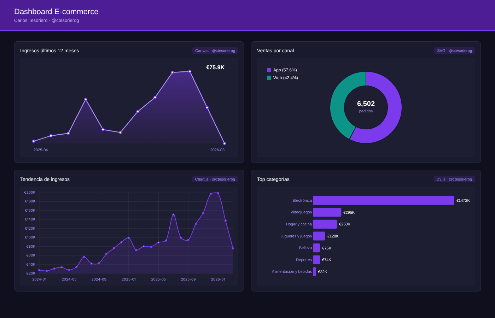

# E-commerce dashboard: four ways to draw a chart on the web

**Live demo: https://ctesorierog.github.io/dashboard-ecommerce/**

A dark-theme dashboard for a fictional e-commerce store. Each panel uses a different web charting technique, from raw Canvas pixels to D3 data joins.



| # | Technique | Chart | Data |
|---|---|---|---|
| 1 | **Canvas 2D API** (vanilla JS) | Sparkline with area fill | Revenue, last 12 months |
| 2 | **SVG** built from JS | Donut chart with centre total | Orders by channel (App vs Web) |
| 3 | **Chart.js** | Smoothed line chart | Monthly revenue trend, 2024–2026 |
| 4 | **D3.js** | Animated horizontal bars | Top categories by revenue |

## Data

The raw dataset is a relational e-commerce workbook (orders, order lines, products, customers, deliveries and returns). It was aggregated into `data.json` after adding calculated columns:

- `IngresoLinea = NumUnidades × PrecioUnitarioVenta × (1 − DescuentoLineaPct)`
- `CosteLinea`, `BeneficioLinea` and `MargenLineaPct` per order line
- `MargenBruto` and `MargenPct` per product
- `RetrasoEntregaDias` (delivery delay) per order

The same data was also modelled in Power BI, with Power Query cleaning, a star-style model and DAX measures. The web version reimplements its key views by hand.

## Run locally

```bash
python -m http.server 8000    # then open http://localhost:8000
```

A local server is needed because browsers block `fetch('data.json')` from `file://`.

## Files

```
index.html   layout
style.css    dark theme
script.js    the four charts
data.json    aggregated data
```

## Context

*Visualización de Datos* course, AI Engineering, Tecnun – Universidad de Navarra, spring 2026.
